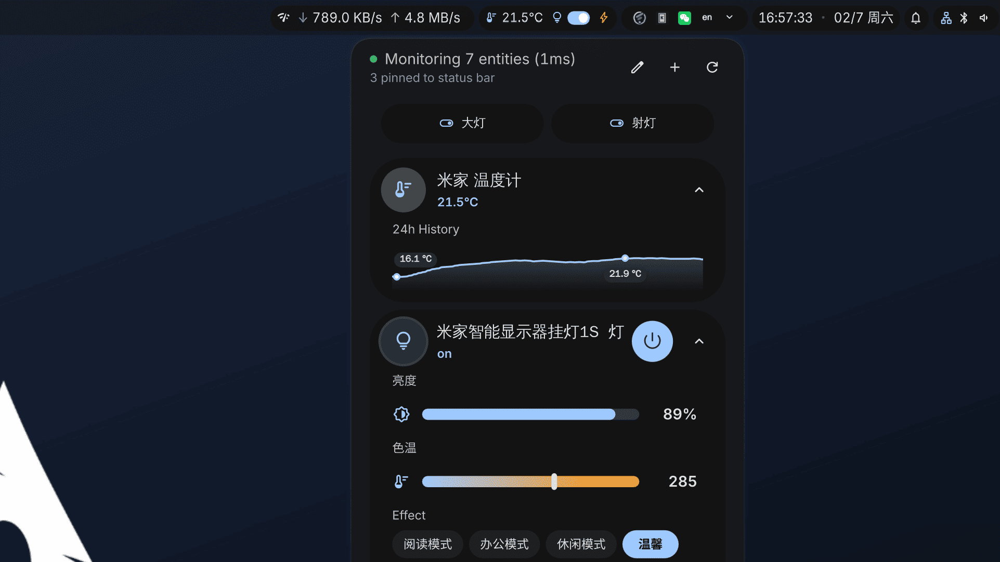

# Home Assistant Monitor for DankMaterialShell



Monitor and control your Home Assistant entities directly from your status bar.

## Features

- **Real-time Monitoring**: WebSocket-based updates for instant state changes.
- **Entity Controls**: Toggle lights, switches, locks, covers, fans, climate devices, and more.
- **Device Details**: Open an animated detail overlay with a fixed entity header, scrollable controls, and related entities.
- **Sensor History**: View 24-hour history with time-proportional spacing, hover timestamps, and loading and empty states.
- **Climate Controls**: Use native on/off actions while showing the target temperature at a glance.
- **Quick Actions**: Pin entities to the status bar or create top-level shortcut buttons.
- **Combination Buttons**: In edit mode, add a named button with fixed actions for multiple entities. Add each property separately (for example fan speed, climate mode, temperature, and fan mode); click an action to edit it. Saving does not control devices. Commands run in order, report failures, and leave unspecified properties unchanged. Configure power or HVAC mode explicitly when needed.
- **Editing Mode**: Sort, rename (double-click), and manage shortcuts easily, with an optional two-column layout.
- **Browser**: Built-in entity browser to find and add devices.

## Requirements

- **DankMaterialShell**: 2.0.0 or later.
- **System Package**: `qt6-websockets`(`qt6-qtwebsockets-devel` for Fedora) is required for operation. 
- **Home Assistant WebSocket API**: Must be accessible (usually enabled by default).
- Long-lived access token.

## Compatibility

Compatibility was checked on November 17, 2026:

| Environment | Verification |
| --- | --- |
| DMS 2.0 release | All 53 referenced DMS public properties and methods checked against release source; not runtime tested. |
| DMS `v2.1.0-108-gdd3ba587b`, Quickshell 0.3.2 | Plugin loading checked in the running shell; HTTP timeout/retry and option controls tested separately in the actual Qt engine. |
| DMS 2.2 documentation | Used as the plugin API and translation reference; not runtime tested on DMS 2.2. |

The manifest passes the official DMS plugin schema. Its dependency metadata does
not install system packages; install the Qt WebSockets package separately.
Other distributions and the full range of Home Assistant versions and device
integrations have not been exhaustively tested.

After changing shared QML components or singleton services, restart DMS fully if
plugin reload retains cached components.

## Configuration

1. Go to Plugin Settings.
2. Enter your **Home Assistant URL** (e.g., `http://homeassistant.local:8123`).
3. Enter your **Long-Lived Access Token**.

## Translations

The plugin follows the DMS language setting (or the system language when unset).
Simplified Chinese is provided in `translations/zh_CN.json`. Missing translations
fall back to the DMS catalogs and then the English source text.

Plugin text uses `I18n.trFor("homeAssistantMonitor", "Connected")`. To add a language,
create `translations/<locale>.json` beside `plugin.json`, using DMS's nested format:

```json
{
  "Connected": {
    "Connected": "已连接"
  }
}
```

Keep the plugin ID and English keys unchanged when translating. After editing a
catalog, reload the plugin or restart DMS to load it.

See the [official DMS plugin translation documentation](https://duxlabs.dev/docs/2.2/dms/plugin-development#plugin-translations).

## Permissions

- `settings_read` / `settings_write`
- `network`: Connect to the configured Home Assistant server and load entity data and media artwork.

## Feedback & Contributions

Suggestions for improvements and feature requests are always welcome.  
If you have ideas, encounter issues, or want to see new features, feel free to open an issue or submit a pull request.
